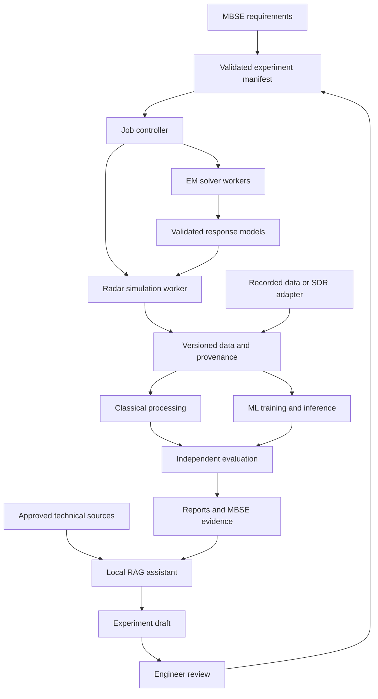

# jfxorss

## AI-Assisted Radar, Electromagnetic Simulation and SDR Integration

**An open architecture for reproducible radar research, computational electromagnetics, signal processing and evidence-based AI assistance.**

[Project repository](https://github.com/robotics-intelligent-systems/jfxorss) · [Existing simulation diagrams](https://github.com/robotics-intelligent-systems/jfxorss/blob/main/MBSE/CAS/Drawio/radar-system-analysis-and-design-using-scilab.drawio)

> **Status:** consolidated architecture proposal, reviewed on September 13, 2026. The repository currently contains a software compendium and initial MBSE simulation diagrams. The services, adapters, AI workflows and deployment profiles described below are proposed development work.

### Suggested GitHub About description

AI-assisted radar and electromagnetic simulation with open-source solvers, SDR integration, reproducible datasets, physics-guided machine learning, local RAG and MBSE traceability.

## 1. Project Overview

jfxorss proposes a modular research platform that connects radar simulation, electromagnetic field solvers, software-defined radio (SDR), classical signal processing and machine learning through explicit data contracts.

The platform would preserve the existing compendium while giving its components defined integration roles. Engineers could specify an experiment, select an appropriate solver, generate or import measurements, compare conventional algorithms with learned models, and produce a report linked to the exact inputs and software revisions.

The recommended alternative is a **physics-based simulation core with optional AI services**. Numerical solvers and measured evidence establish the reference results. AI can help interpret documentation, identify data-quality problems, develop learned representations and approximate expensive calculations within a validated domain.

The architecture supports education, laboratory instrumentation, civil sensing, antenna research, robotics perception and subsurface inspection. Each application requires its own datasets and acceptance criteria; success in one domain does not establish performance in another.

## 2. Current Baseline and Proposed Evolution

The reviewed [README](https://github.com/robotics-intelligent-systems/jfxorss/blob/main/README.md) lists 23 projects or research components. The inspected repository tree includes an initial two-page draw.io file under `MBSE/CAS/Drawio/`. It does not yet contain the implementation proposed here or a root software license file.

| Area | Observed baseline | Proposed evolution |
| --- | --- | --- |
| Project description | Radar and electromagnetic software compendium | Consolidated scope, component roles and integration decisions |
| Systems engineering | MBSE/CAD/CAM/CAS organization described in the README | Requirements, interfaces, verification cases and evidence links |
| Simulation diagrams | Initial draw.io pages | Connected functional and deployment architecture |
| Executable platform | No application implementation in the inspected tree | Small Python application with isolated solver workers |
| AI integration | Radar ML tools mentioned | Reproducible training, evaluation and local documentation assistance |
| Release management | No integrated platform release established | Pinned dependencies, dataset manifests and reproducible release records |

Each integration will require an implementation and compatibility assessment.

## 3. Architecture Decisions

| Decision | Rationale |
| --- | --- |
| Begin with simulation and recorded-data replay | Establish reproducibility before introducing live acquisition |
| Use one application service and a worker interface for the MVP | Keep deployment and debugging manageable |
| Keep each solver behind an adapter | Preserve native numerical assumptions, dependencies and licensing |
| Establish a classical processing baseline before training AI | Make the incremental value of ML measurable |
| Separate scientific computation from the language-model assistant | Keep numerical results traceable to executable calculations |
| Use local storage and local inference by default | Support work without mandatory external AI services |
| Add hardware, distributed execution and specialized solvers incrementally | Expand only when an experiment demonstrates a concrete need |

## 4. Reference Integration Architecture

The diagram describes the proposed relationships. An adapter must be implemented and validated for each connected tool.



### Integration layers

| Layer | Proposed responsibility | Initial implementation |
| --- | --- | --- |
| Requirements and experiment design | Define objectives, assumptions, scenarios and acceptance criteria | MBSE records, YAML manifests and JSON Schema |
| Solver execution | Run reproducible numerical jobs | Python adapters and isolated processes or containers |
| Data and provenance | Preserve raw inputs, outputs, units, calibration and lineage | SigMF, HDF5, Parquet and content hashes |
| Scientific processing | Produce reference features and estimates | NumPy/SciPy; proposed Scilab teaching notebooks |
| Machine learning | Train and evaluate models against the reference pipeline | scikit-learn, PyTorch and an NRDK adapter |
| Knowledge assistance | Answer technical questions with source references | Local retrieval, llama.cpp and an optional LangGraph workflow |
| Experiment management | Record configurations, metrics and model artifacts | MLflow and a project artifact catalog |
| User access | Inspect experiments and compare results | JupyterLab; a FastAPI service when shared access is needed |

### Coupling electromagnetic and radar simulations

An electromagnetic solver and a radar signal simulator operate at different levels of abstraction. Their outputs must not be treated as interchangeable.

An adapter should extract a documented response product, such as a frequency response, radiation pattern or scattering response, together with polarization, coordinate conventions, normalization and validity limits. The radar simulator may then consume that response through an explicit interpolation and transformation step.

For the MVP, validate a simple reference geometry and one response exchange. Large scenes can use simplified propagation models, with selected high-fidelity calculations used to check their assumptions. Running every scene through a full-wave solver is not a prerequisite for useful radar research.

## 5. Consolidated Software Compendium

The following tables preserve all 23 entries from the original description. **Core candidate** means recommended for early integration; **extension** means optional; **reference** means retained for study or interoperability work. These are architecture choices, not statements of implementation status.

### Radar simulation, SDR and semantic integration

| Component | Proposed role | Adoption decision |
| --- | --- | --- |
| [GnuRadar](https://github.com/rseal/GnuRadar) | Study existing USRP 1 radar acquisition and processing workflows | **Reference.** Hardware-specific; verify its build environment and exact driver requirements |
| [FMCW-MIMO-Radar-Simulation](https://github.com/ekurtgl/FMCW-MIMO-Radar-Simulation) | Educational FMCW/MIMO processing examples and numerical comparisons | **Reference.** MATLAB scripts; a Python or Scilab adaptation needs license review and numerical equivalence checks |
| [Hardware Architecture Design for Parallel AESA Radar Signal Processing](https://github.com/David-R-A/AESA-radar) | Study partitioning of signal-processing workloads | **Reference.** Resolve reuse terms and toolchain dependencies before adopting code |
| [AERIS-10](https://github.com/NawfalMotii79/PLFM_RADAR) | Open hardware/software architecture reference | **Extension.** Review licenses per hardware, firmware and software asset; do not inherit published performance claims |
| OSSIE | Preserve the original compendium's SDR framework reference | **Reference.** Confirm the canonical release, license and compatibility before implementing an adapter |
| [PySOSA](https://github.com/landrs-toolkit/PySOSA) | Describe sensors, observations and samples as RDF | **Extension.** Apache-2.0 project; evaluate API coverage against the selected ontology version |
| [REDHAWK](https://github.com/RedhawkSDR/core-framework) | Interoperate with existing SDR component applications | **Extension.** Core framework reports LGPL-3.0; inspect dependencies and supported environments |
| [REOS](https://github.com/bgin/Radar_ElectroOptical_Simulation) | Specialized numerical kernels and radar/electro-optical studies | **Extension.** MIT repository; validate selected kernels and compiler requirements independently |
| ANTARES | Preserve the original compendium's naval-radar simulation reference | **Reference.** A canonical source distribution and license were not established in this review |
| [RadarSimPy](https://github.com/radarsimx/radarsimpy) | Optional radar transceiver and scene-simulation adapter | **Extension.** Public Python code does not establish an entirely source-buildable runtime; see the dependency note below |
| [Neural Radar Development Kit — NRDK](https://github.com/RadarML/nrdk) | Radar and multimodal ML data/model interfaces | **Core AI candidate.** MIT; adapt project datasets explicitly to the selected NRDK release |

PySOSA uses the W3C **Sensor, Observation, Sample, and Actuator** ontology. This is a semantic-data role and does not establish conformance to the separate Sensor Open Systems Architecture hardware standard. See the [PySOSA introduction](https://github.com/landrs-toolkit/PySOSA) and [W3C SSN/SOSA specification](https://www.w3.org/TR/vocab-ssn/).

RadarSimPy's official documentation describes licensed operation modes and states that building the simulator requires access to `radarsimcpp` source. Therefore, the proposed fully open software baseline must remain executable without RadarSimPy. Its adapter is optional and subject to the selected distribution's terms. See the [installation documentation](https://radarsimx.github.io/radarsimpy/user_guide/installation.html) and [build documentation](https://radarsimx.github.io/radarsimpy/user_guide/build.html).

### Electromagnetic and multiphysics simulation

| Component | Proposed role | Adoption decision |
| --- | --- | --- |
| [NEC2++](https://github.com/tmolteno/necpp) | NEC-based antenna analysis and compact response models | **Extension.** Check geometry assumptions and convergence |
| [Xnec2c](https://github.com/KJ7LNW/xnec2c) | Antenna pattern analysis and interactive inspection | **Extension.** Preserve solver settings and result provenance |
| [xnec2c-optimize](https://github.com/KJ7LNW/xnec2c-optimize) | Repeatable antenna-design parameter studies | **Extension.** Compare optimization outputs with independently rerun solver cases |
| [Elmer](https://github.com/ElmerCSC/elmerfem) | Multiphysics studies, including thermal and electromagnetic interactions | **Extension.** Choose the relevant solver and coupling assumptions |
| [DOLFINx / FEniCSx](https://github.com/FEniCS/dolfinx) | Custom finite-element formulations and research methods | **Extension.** Requires a validated formulation; not a turnkey radar simulator |
| [Palace](https://github.com/awslabs/palace) | Parallel finite-element electromagnetic simulation | **Extension.** Candidate when a frequency-domain FEM study is justified |
| [Meep](https://meep.readthedocs.io/en/latest/) | Time-domain electromagnetic studies and selected comparison cases | **Extension.** Choose suitable materials, boundaries and discretization |
| [gprMax](https://github.com/gprMax/gprMax) | Ground-penetrating radar and subsurface propagation studies | **Domain extension.** Validate material and geometry assumptions for each inspection task |
| [Bempp-cl](https://github.com/bempp/bempp-cl) | Boundary-element formulations and surface-based studies | **Extension.** Validate the chosen operator formulation and acceleration backend |
| [OpenParEM](https://openparem.org/) | Frequency-domain waveguide, port and full-wave electromagnetic studies | **Extension.** Import documented field, port or radiation products |
| [openEMS](https://github.com/thliebig/openEMS) | Initial full-wave electromagnetic worker | **Core physics candidate.** FDTD solver with Python/Octave interfaces; integrate through a dedicated environment |
| [Puma-EM](https://github.com/Gjacquenot/Puma-EM) | Surface integral and fast-multipole electromagnetic studies | **Extension.** Qualify numerical cases and toolchain compatibility before adoption |

These solvers address different physical formulations. Selecting one should follow the experiment's physics, boundary conditions, geometry and verification needs.

## 6. Additional Open-Source Integration Components

| Capability | Proposed component | Purpose |
| --- | --- | --- |
| Classical DSP | [NumPy](https://numpy.org/), [SciPy](https://docs.scipy.org/doc/scipy/tutorial/signal.html) | Array processing, spectral analysis, filtering and numerical reference implementations |
| Recorded/live SDR integration | [GNU Radio](https://github.com/gnuradio/gnuradio), [UHD](https://github.com/EttusResearch/uhd) where supported | Build an acquisition/replay adapter for a specifically qualified device |
| Baseline ML | [scikit-learn](https://github.com/scikit-learn/scikit-learn) | Compact supervised and anomaly-detection baselines |
| Neural models | [PyTorch](https://github.com/pytorch/pytorch), NRDK | Learn radar representations and evaluate multimodal models |
| Experiment tracking | [MLflow](https://mlflow.org/docs/latest/ml/) | Link configurations, metrics, datasets and model artifacts |
| API | [FastAPI](https://fastapi.tiangolo.com/) | Expose typed experiment and result interfaces |
| Local inference | [llama.cpp](https://github.com/ggml-org/llama.cpp) | Serve a compatible locally stored language model |
| Assistant workflow | [LangGraph](https://docs.langchain.com/oss/python/langgraph/overview) | Implement a bounded retrieve, draft, review and report workflow |
| Shared metadata and retrieval | [PostgreSQL](https://www.postgresql.org/docs/current/index.html), [pgvector](https://github.com/pgvector/pgvector) | Store experiment metadata and searchable document embeddings |
| Signal interchange | [SigMF](https://sigmf.org/) | Preserve signal recordings with machine-readable metadata |

A minimal workstation profile can use local files and a small metadata database before adding PostgreSQL. GNU Radio/UHD support for a selected device must be checked separately; compatibility with GnuRadar's USRP 1 path is not assumed.

The inference engine's license does not cover model weights, embedding models or training datasets. Select those artifacts separately and record their licenses, revisions and redistribution terms. No particular model is approved or bundled by this proposal.

## 7. AI Workstreams

| Workstream | Proposed approach | Required evidence |
| --- | --- | --- |
| Signal-quality assessment | Statistical features followed by a compact anomaly model | Measured error rates on independent recordings and labeled corruption cases |
| Radar representation learning | PyTorch/NRDK models operating on documented signal or spectral tensors | Comparison with classical features on held-out sessions and devices |
| Civil scene classification | Supervised models for a clearly defined research dataset | Per-class metrics, calibration and performance under domain changes |
| Simulation surrogates | Regression or neural models trained on validated solver outputs | Error bounds over a declared operating domain and confirmation with the original solver |
| Multimodal experiments | Radar plus synchronized auxiliary sensor features | Time-alignment checks, missing-sensor evaluation and modality ablations |
| Engineering copilot | Retrieval-augmented answers and structured experiment drafts | Correct citations, explicit uncertainty and valid configuration proposals |

### Evaluation discipline

Split data by acquisition session, environment, subject where applicable, or simulation scenario before generating training examples. Adjacent frames and minor variants of the same simulated scene must not leak across training and test partitions.

Report dataset composition, random seeds, preprocessing, confidence intervals and hardware used for evaluation. Select detection thresholds and calibration parameters on development data, then freeze them before testing.

For synthetic-to-real experiments, reserve real recordings for independent evaluation and report the performance gap. Synthetic accuracy alone cannot establish real-world validity.

Surrogate models should identify out-of-domain inputs and defer to a validated solver. Speed improvements must include preprocessing and inference overhead, with error measured against the same reference problem.

### Local engineering copilot

The assistant would retrieve from approved upstream documentation, project requirements, experiment manifests and completed reports. Each answer should cite the relevant document revision or experiment identifier.

Its initial tools should be limited to searching documentation, inspecting metadata, comparing completed runs and producing draft manifests. Job submission can be added through an authenticated, schema-validated service with explicit resource limits. Retrieved documents are evidence, not executable instructions.

An optional Model Context Protocol interface could expose these same typed operations to external development clients. It would be an adapter to the application API, not a second execution or authorization system.

## 8. Data Contracts and Provenance

| Artifact | Recommended representation | Required metadata |
| --- | --- | --- |
| Raw signal recording | SigMF data and metadata | Sample format, sampling information, channel description, time source and calibration references |
| Derived radar tensor | HDF5 with explicitly named dimensions | Dimension order, units, channel ordering, coordinate frame and processing revision |
| EM response product | HDF5 or solver-native output plus a manifest | Frequency axis, polarization, normalization, reference plane and validity limits |
| Scenario and geometry | Versioned parameter file and referenced geometry assets | Coordinate system, units, material model and asset rights |
| Labels and evaluation results | Parquet or structured JSON | Label definition, split assignment, provenance and evaluation configuration |
| Model artifact | Native model format; optional qualified export | Dataset revisions, preprocessing, training settings and model license |
| Report | Markdown plus referenced numerical artifacts | Requirement IDs, run IDs, conclusions, limitations and source links |

Do not encode an arbitrary multidimensional radar tensor as if its complete semantics were supplied by SigMF alone. Preserve the required axes and channel mapping in the derived-data contract.

Use immutable run identifiers and hashes for inputs and outputs. Store large arrays outside the relational database; keep their references and metadata in the catalog. Record the conversion between simulation time, device sample time and wall-clock time where applicable.

### Illustrative experiment manifest

This is a proposed contract example. The schema, CLI and referenced artifacts must be implemented before it can be executed.

```yaml
schema: jfxorss.experiment/v1
experiment_id: civil-reference-001
requirements:
  - REQ-REPRODUCIBILITY-001
mode: simulation
scenario_ref: scenarios/civil-reference.yaml
seed: 42

pipeline:
  simulation_adapter: numpy_reference
  response_model_ref: responses/reference-response.manifest.json
  processing_profile: classical_baseline
  learned_model_ref: null

evaluation:
  split_manifest_ref: datasets/splits/session_holdout.json
  acceptance_profile_ref: validation/reference_acceptance.yaml
  reference_result_ref: validation/reference-result.manifest.json

provenance:
  record_source_revision: true
  record_environment_digest: true
  hash_inputs_and_outputs: true

execution:
  network_access: false
  timeout_seconds: 900
  max_memory_gib: 8
```

The resource limits above are illustrative controls, not measured sizing recommendations. A build step must resolve references and reject incompatible dimensions, missing units and unsupported adapter capabilities before a run is accepted.

## 9. Adapter and Execution Design

Each solver adapter should implement a small lifecycle:

1. **Describe capabilities:** accepted inputs, output products, supported platforms and required licenses.
2. **Validate:** check configuration, geometry references, units and resource estimates.
3. **Prepare:** create an isolated working directory and resolved input manifest.
4. **Run:** invoke a pinned solver with bounded resources and captured logs.
5. **Collect:** normalize supported outputs and calculate artifact hashes.
6. **Report:** return completion status, numerical warnings and provenance.

The job controller should handle cancellation, retries for transient execution failures and restart recovery. Numerical divergence should be recorded as a failed experiment, rather than silently retried with different physics settings.

CPU execution is the initial portability target. GPU acceleration, MPI and cluster scheduling are extensions that require solver-specific support and measured benefit. A container boundary helps isolate environments but does not by itself resolve third-party license obligations.

For live acquisition, keep device timing and data movement within the qualified acquisition process. Language-model calls, report generation and batch job scheduling must remain outside timing-sensitive signal paths.

## 10. MBSE Integration and Proposed Repository Organization

Maintain the existing MBSE organization and extend it as implementation develops.

| Path | Status / proposed purpose |
| --- | --- |
| `README.md` | Existing project entry point; this document is a proposed replacement description |
| `MBSE/CAS/Drawio/` | Existing initial simulation diagrams |
| `MBSE/requirements/` | Proposed requirement IDs and acceptance criteria |
| `MBSE/CAD/` | Described in the original structure; proposed geometry and material references |
| `MBSE/CAM/` | Described in the original structure; proposed fabrication and assembly records when applicable |
| `MBSE/CAS/scenarios/` | Proposed simulation cases and solver configuration records |
| `src/jfxorss/adapters/` | Proposed solver and acquisition adapters |
| `src/jfxorss/processing/` | Proposed classical processing pipelines |
| `src/jfxorss/ai/` | Proposed models, retrieval and assistant workflows |
| `schemas/` | Proposed experiment and artifact contracts |
| `tests/reference_cases/` | Proposed numerical and interoperability cases |
| `notebooks/` | Proposed tutorials and reproducible analyses |
| `deploy/` | Proposed local and shared deployment definitions |
| `docs/reports/` | Proposed reviewed experiment reports |
| `third_party/` | Proposed attribution, dependency records and licensing notes |

Trace each requirement to an architecture component, an experiment manifest and a verification result. Capella/Arcadia may support the systems model, while draw.io communicates selected views. Documentation diagrams do not substitute for executable interface validation.

No installation command is claimed for jfxorss at this stage: the package, adapters and deployment files are deliverables of the roadmap below.

## 11. Implementation Roadmap

Durations are planning estimates for a small multidisciplinary team, beginning after scope and staffing are agreed.

| Phase | Indicative duration | Concrete deliverables | Exit criterion |
| --- | --- | --- | --- |
| 0 — Scope and qualification | 1–2 weeks | Civil reference scenario, component register, license inventory, data contract and acceptance criteria | Scope is bounded and all MVP dependencies are identified |
| 1 — Reproducible baseline | 2–3 weeks | NumPy/SciPy simulation and processing, recorded-data import, run manifests and first report | Reference runs can be reproduced from pinned inputs |
| 2 — Physics integration | 2–3 weeks | openEMS worker and one documented EM response exchange | Reference geometry and response conversion pass numerical checks |
| 3 — ML comparison | 2–3 weeks | scikit-learn baseline, PyTorch/NRDK adapter and independent evaluation report | Learned model is evaluated on the same frozen test set as the baseline |
| 4 — Knowledge assistance | 1–2 weeks | Local retrieval, cited answers and structured experiment drafts | Evidence and configuration checks pass on a curated evaluation set |
| 5 — Shared laboratory pilot | 2–4 weeks | Shared catalog/API, access control, recovery checks and optional device replay adapter | Pilot users complete and reproduce an end-to-end experiment |

The sequence represents approximately **10–17 weeks** of scoped work. Procurement, field data collection, hardware qualification and domain-specific validation may require separate schedules.

### Minimum viable demonstration

A user selects a reference scenario, runs the baseline simulation, inspects a recorded-data example, compares classical and learned outputs, and exports a Markdown report containing the exact manifests and evaluation results. The assistant explains that report with citations.

A valid outcome may be that a learned model fails to improve on the baseline. The platform's first success criterion is reliable evidence.

## 12. Verification and Success Measures

| Area | Verification approach | Acceptance rule to define before testing |
| --- | --- | --- |
| Reproducibility | Re-run pinned inputs in the supported environment | Matching hashes where deterministic; documented numerical tolerance otherwise |
| Physics | Analytical or published reference cases and convergence studies | Per-case error and convergence thresholds |
| Interoperability | Check known coordinate, unit, polarization and timing conversions | No silent conversion; all required metadata validated |
| Classical processing | Small reference signals and recorded-data checks | Expected numerical behavior within declared tolerance |
| AI effectiveness | Frozen held-out evaluation and baseline comparison | Application-specific error, calibration and uncertainty limits |
| Domain transfer | Evaluate independent environments or devices | Report degradation and restrict claims to evaluated conditions |
| Assistant quality | Questions with known source evidence and adversarial documents | Correct references, supported claims and rejection of invalid tool requests |
| Operational performance | Measure complete jobs and pipeline latency | Explicit CPU/GPU, memory and elapsed-time budgets |
| Recovery | Interrupted and failed job scenarios | No lost provenance or duplicate completed-run identity |

Publish measured results after validation. This proposal makes no unsupported claims about accuracy, detection range, real-time capability or percentage cost savings.

## 13. Licensing, Attribution and Contribution

The repository's existing description identifies concept images as reference material and discusses non-profit numerical analysis. Those statements do not establish a general open-source license for every repository asset. Preserve the original rights notices and obtain the necessary rights before redistributing third-party material.

The maintainers should select an explicit license for original project code and separately identify documentation, model, dataset and hardware licenses. Apache-2.0 is a possible choice for newly written integration code, subject to the actual dependency and distribution structure; it is not declared as the repository's current license.

Before promoting a component into the supported stack:

- Record its canonical source, pinned revision, license files and required notices.
- Distinguish software source, runtime binaries, model weights, datasets and hardware designs.
- Verify that the selected distribution can be obtained and used under its stated terms.
- Keep optional restricted or unverified dependencies out of the fully open baseline.
- Preserve upstream attribution and document modifications.

Contributions should include the problem being solved, the adapter or model interface, a reproducible reference case and evidence supporting the result. AI-assisted contributions remain subject to the same technical review.

## 14. Expected Project Outcome

jfxorss can evolve from a list of research tools into a coherent experimentation platform: requirements lead to executable experiments, solvers produce traceable numerical evidence, classical and learned methods can be compared fairly, and a local assistant helps engineers understand the results.

The initial deliverable is a reproducible software laboratory. Additional solvers, hardware integrations and AI capabilities should be added when their scientific value and integration quality have been demonstrated.
